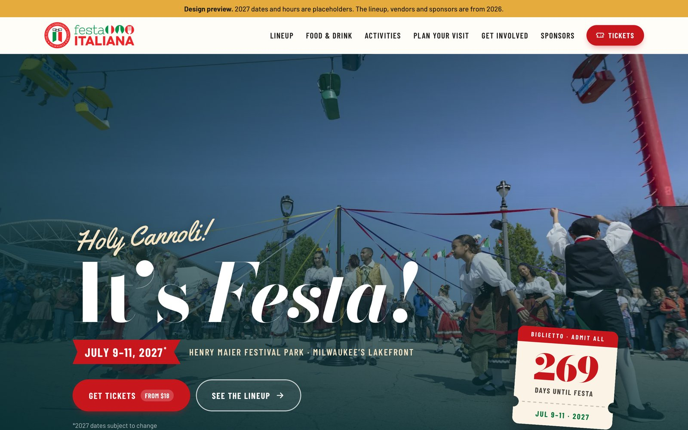

# Festa Italiana Milwaukee: website redesign

A proposed redesign of [festaitaliana.com](https://festaitaliana.com) for the Italian Community Center's Festa Italiana. It's a static site with no build step: open `index.html` or host the folder anywhere (GitHub Pages, Netlify, or the ICC's existing WordPress host).

**Live preview:** https://zuvv.github.io/FestaItaliana/



## Run it

Open `index.html` directly in a browser, or serve the folder:

```bash
npx http-server FestaItaliana -p 8110
```

## Update content

Everything that changes each year lives in **`js/data.js`**: dates, gate hours, ticket prices and link, the lineup, food vendors, sponsors and outside links. Nobody has to touch the HTML to roll the site over to a new year.

| To change… | Edit in `js/data.js` |
| --- | --- |
| Festival dates | `festival.start`, `festival.end`, `datesConfirmed` |
| Gate hours | `days[]` |
| Ticket prices / store link | `tickets` |
| Who's playing when | `lineup[]` (day, start/end in 24h, stage key, name, tag, blurb) |
| Food vendors | `vendors[]` |
| Sponsor logos | `sponsors[]` (files in `assets/img/sponsors/`) |
| Remove the "design preview" bar | `preview: false` |

## What we're improving

**Current festaitaliana.com (2026)**
- No navigation. Every button opens a different page on iccmilwaukee.com in a new tab.
- The homepage doesn't show the dates, hours, ticket prices or a "Buy tickets" button.
- The lineup only exists as ~20 flyer images. Nobody can search it, Google can't index it, and screen readers can't read it.
- Food vendors are also only logo images.
- The "Volunteer info" link on the ICC page is an Outlook safelinks redirect copied from an email.
- Scroll-in animations leave sections invisible until they fire.

**What German Fest does well (and we borrowed)**
- Dates and a big ticket button in the hero
- A full menu (Tickets · Entertainment · Activities · Food & Drink · Info) plus a full-sitemap footer
- "Know before you go" visitor info, a sponsor wall, and newsletter signup

**Where this design goes further than both**
- **One page answers the big questions.** When, where and how much are all visible without scrolling, and tickets are one tap from anywhere through the sticky header.
- **A real, filterable lineup.** Browse by day and by stage, as text Google can index and screen readers can read.
- **Food as real content.** 14 vendors filterable by Pizza / Pasta & Plates / Street Food / Dolci.
- **Real 2025 festival photography** throughout, instead of three soft stock-style slides.
- **A countdown "ticket stub"** that switches to "Oggi!" during the festival and "Grazie" afterward.
- **Visitor info in plain language:** a bag-policy summary, South Gate entry for Festa Mass, and an FAQ.
- **Built for phones first.** No horizontal scroll, 44px tap targets, and a reduced-motion setting is respected.
- **Fast.** Photos converted to WebP (≈1.7 MB total, lazy-loaded), and no jQuery or page builder.
- **On-brand.** The logo red/green, checkered tablecloth, tricolor brush strokes and the Italian-icon pattern all come from Festa's own assets. Bodoni (an Italian typeface from Parma) adds the "heritage and elegance" their copy talks about.

## Before launch, confirm with the ICC

- [ ] 2027 dates and gate hours (currently tentative July 9–11, 2027, using 2026 hours)
- [ ] 2027 lineup, stages and times (2026 data used as placeholder)
- [ ] 2027 ticket product link and prices ($18 GA / $45 3-pack in 2026)
- [ ] Newsletter provider (form is a demo; hook to Mailchimp/Constant Contact)
- [ ] Photo usage rights and credits. Most photos come from the 2025 festival set (the `Festa2025_strobel-*` files look like a pro photographer's, so confirm the name for the footer credit).
- [ ] Font choice: the current site uses the licensed *Broadley* family. Swap it into the `--f-*` variables in `css/styles.css` if the license covers it.
- [ ] Details for La Cucina Showcase, kids pizza contest, fireworks times, Heritage Exhibit theme
- [ ] Analytics + privacy policy link

## Structure

```
index.html            page markup
css/styles.css        design tokens + all styles
js/data.js            all yearly content
js/main.js            rendering: lineup, food, sponsors, countdown, menu
assets/img/photos     optimized WebP photos (cropped + resized from the 2025 set)
assets/img/brand      logos, separator, favicons
assets/img/sponsors   sponsor logos
assets/img/textures   Festa pattern/texture backgrounds
docs/                 screenshots for sharing
Festa 2025/           raw photo dump (not committed; see .gitignore)
```

To use a different photo, drop the original in `Festa 2025/`, add a line to the crop list in the build script, and re-export. The site only ever loads the small WebP copies in `assets/img/photos`.
